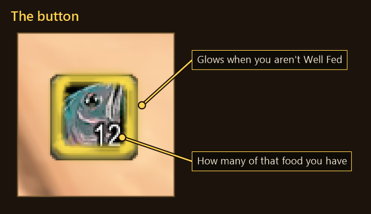
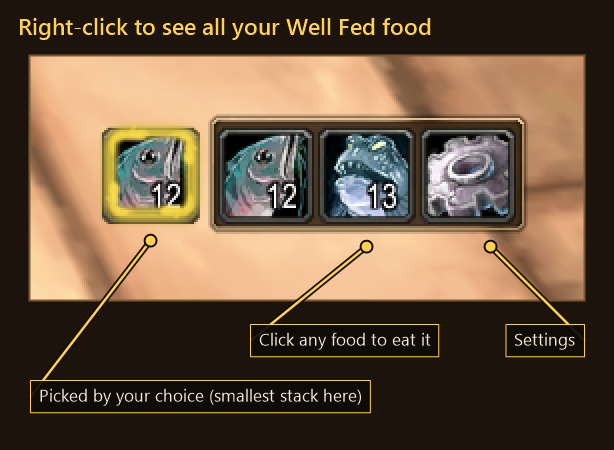
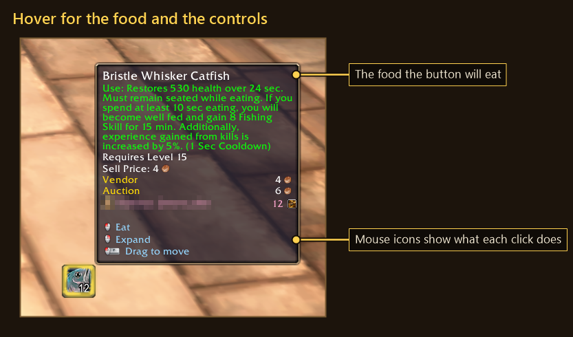
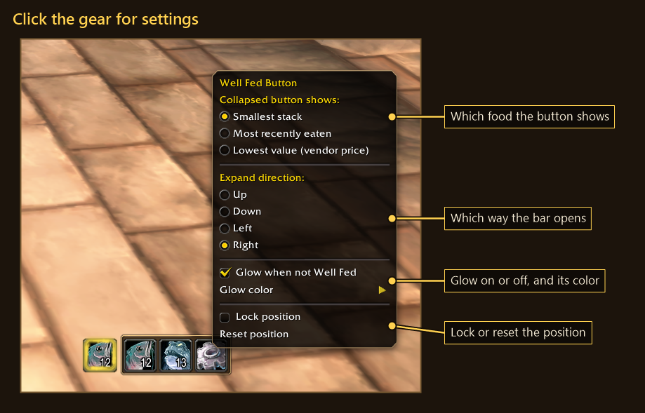

# Well Fed Button

A WoW Forever addon that puts all the Well Fed food in your bags into one button. Click to eat. The button glows when you're missing the buff, so you remember to eat before the next pull.


## Screenshots









## Features

- One button for every Well Fed food in your bags, with a count.
- Right-click to open a bar with each Well Fed food; click any of them to eat it.
- Glows while you're alive and not Well Fed (blue, gold, green or white, or off).
- Choose which food the button shows: smallest stack, last eaten, or cheapest.
- Greys out when you can't eat, like an action bar button.
- Hotkeys to eat and to open the bar (Key Bindings → AddOns).

## Usage

| Action | Result |
|---|---|
| Left-click | Eat |
| Right-click | Open or close the food bar |
| Shift + drag | Move the button |
| Gear button (end of the bar) | Settings |

Slash commands: `/wfb` or `/wellfed`. Run `/wfb` on its own for the list.

## Requirements

- WoW Forever (interface 16001)

## Development

The tests syntax-check the addon under Lua 5.1, check widget methods against Forever's API docs, and test the release helpers:

```bash
pip install lupa
python tests/run.py
```

## Releasing

Pushing an annotated `v<version>` tag on `main` runs the Release workflow. It checks the tag against the `.toc` version and `CHANGELOG.md`, then tests, zips, creates the GitHub release and uploads to CurseForge. The tag's message is the release notes. The release skill in `.claude/skills/release` walks through it.

The CurseForge upload is skipped until the repo has a `CURSEFORGE_TOKEN` secret and a `CURSEFORGE_PROJECT_ID` variable.

## License

MIT. See [LICENSE](LICENSE).
